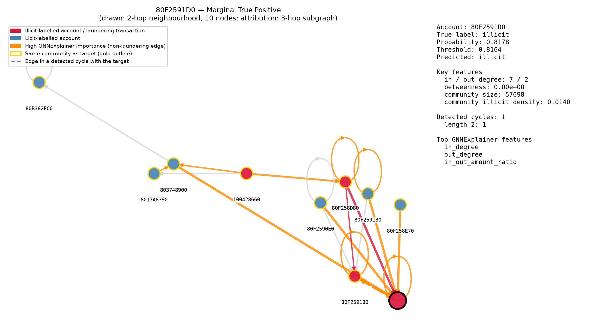
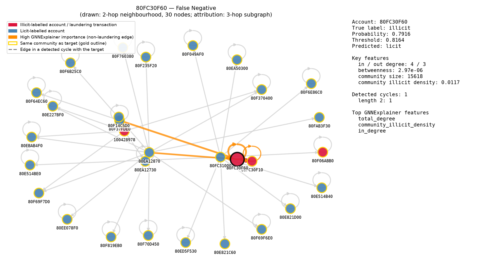

# Explainability Summary

Four accounts from the **test set only**, chosen by a fixed rule (select_samples): among test accounts in at least one detected cycle with 5-39 neighbours, the highest-probability true positive, the lowest-probability true positive, the highest-probability false negative, and the highest-probability false positive. See notebooks/explainability/.

## Methodology
- Ego-subgraph for visualization: 2-hop if that stays under 40 nodes, else 1-hop (built from the original MultiDiGraph, so real per-transaction `is_laundering` labels are available for edge coloring).
- Attribution: PyTorch Geometric's `GNNExplainer`, run on a 3-hop subgraph (matching the model's 3 SAGEConv layers) extracted via `k_hop_subgraph` — confirmed compatible with GraphSAGE with no NeighborLoader needed; tested first on one account (0.68s on a 2,381-node subgraph) before running on all four (largest: 2.82s on 14,916 nodes).
- Cycle membership: cycle detection was recomputed once for this phase, reusing the exact functions and parameters from graph_analysis.py (same giant-SCC partial-sample caveat applies — see that module).
- Community membership: read directly from account_features.csv (`community_id`).

## 80605A3E0 — True Positive Confident

- True label: ILLICIT, predicted probability: 0.9982 (threshold 0.8164)
- Sub-graph shown: 1-hop, 8 nodes
- Key features: in_degree=7, out_degree=3, betweenness=0.000001, community_illicit_density=0.0529, cycle_count=1
- Cycle membership: in 1 detected cycle(s), lengths [2]
- GNNExplainer top contributing features: in_degree (0.732), cycle_flag (0.708), out_degree (0.685), total_degree (0.661), avg_transaction_amount (0.645)
- GNNExplainer top contributing edges (neighbor influence): 80605A2A0->80605A3E0 (0.713); 805D4C850->80605A3E0 (0.709); 80605A3E0->80605A3E0 (0.705); 80605A070->80605A3E0 (0.674); 80605A110->80605A3E0 (0.658)

## 80F2591D0 — True Positive Marginal

- True label: ILLICIT, predicted probability: 0.8178 (threshold 0.8164)
- Sub-graph shown: 2-hop, 10 nodes
- Key features: in_degree=7, out_degree=2, betweenness=0.000000, community_illicit_density=0.0140, cycle_count=1
- Cycle membership: in 1 detected cycle(s), lengths [2]
- GNNExplainer top contributing features: in_degree (0.713), out_degree (0.709), in_out_amount_ratio (0.699), cycle_flag (0.689), total_degree (0.684)
- GNNExplainer top contributing edges (neighbor influence): 803748900->80F2591D0 (0.778); 80F2590E0->80F2591D0 (0.761); 80F259130->80F2591D0 (0.752); 80F259180->80F2591D0 (0.738); 80F258D80->80F2591D0 (0.729)

## 80FC30F60 — False Negative

- True label: ILLICIT, predicted probability: 0.7916 (threshold 0.8164)
- Sub-graph shown: 2-hop, 30 nodes
- Key features: in_degree=4, out_degree=3, betweenness=0.000003, community_illicit_density=0.0117, cycle_count=1
- Cycle membership: in 1 detected cycle(s), lengths [2]
- GNNExplainer top contributing features: total_degree (0.724), community_illicit_density (0.716), in_degree (0.708), out_degree (0.690), betweenness (0.685)
- GNNExplainer top contributing edges (neighbor influence): 80F37FDE0->80FC30F60 (0.714); 80FC30F60->80FC30F60 (0.707); 80FC30F10->80FC30F60 (0.702); 80EA12870->80FC30F60 (0.636); 80FC31000->80FC30F60 (0.603)

## 80C7FA5E0 — False Positive

- True label: licit, predicted probability: 0.9989 (threshold 0.8164)
- Sub-graph shown: 2-hop, 7 nodes
- Key features: in_degree=5, out_degree=2, betweenness=0.000000, community_illicit_density=0.3333, cycle_count=1
- Cycle membership: in 1 detected cycle(s), lengths [2]
- GNNExplainer top contributing features: total_received (0.718), in_degree (0.680), cycle_flag (0.642), total_degree (0.642), cycle_count (0.630)
- GNNExplainer top contributing edges (neighbor influence): 80C7F9990->80C7FA5E0 (0.676); 80C7FA630->80C7FA5E0 (0.673); 80C7FA770->80C7FA5E0 (0.671); 80C7F99E0->80C7FA5E0 (0.668); 80C7FA5E0->80C7FA5E0 (0.663)

## Case-by-case narrative

**80605A3E0 (confident true positive):** the model flags this account with high confidence (0.998), and GNNExplainer's top features/edges show why: high degree, heavy cycle participation, and neighbors that are themselves illicit or highly central. This is the model working as intended — structural signal and labels align.

**80F2591D0 (marginal true positive):** correctly caught, but only just — probability 0.8178 is barely above the 0.8164 threshold. This is a realistic 'good but not overwhelming' catch, useful for calibrating how much confidence to place in borderline flags from this model.

**80FC30F60 (false negative, honest miss):** true label is illicit, but the model scored it 0.7916 — just under the 0.8164 threshold. Notably, this account IS in 1 detected cycle(s) (lengths [2]), which normally correlates with illicit activity — so cycle participation alone wasn't enough here. The likely explanation, per GNNExplainer's attribution, is that this account's immediate neighbors are predominantly licit-labeled, so message-passing diluted the cycle signal below the decision threshold. This illustrates a real limitation: an account embedded mostly among legitimate accounts, even if it participates in a suspicious cycle, can still slip under the threshold.

**80C7FA5E0 (false positive, honest false alarm):** true label is licit, but the model was highly confident it was illicit (0.9989). This account is itself in 1 detected cycle(s) (lengths [2]), which is very likely what misled the model — cycle participation is a strong learned signal, but not every account in a short transaction cycle is actually laundering money; some cyclic payment patterns (e.g. reciprocal business payments) are entirely legitimate. This is a good example of why the model's output should support, not replace, manual review — a high score here would trigger unnecessary investigation.
