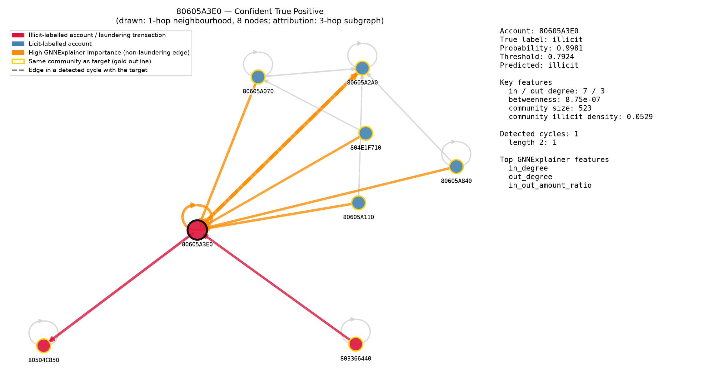
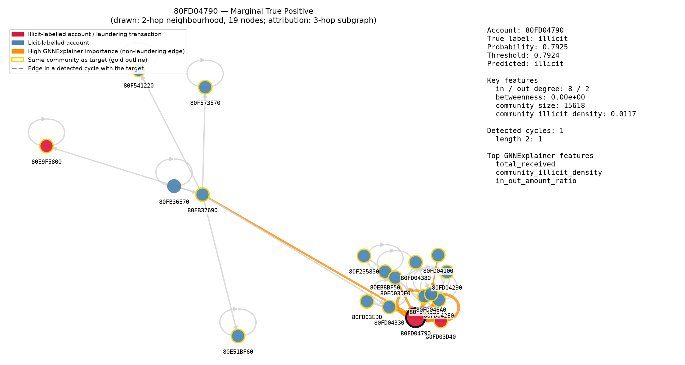
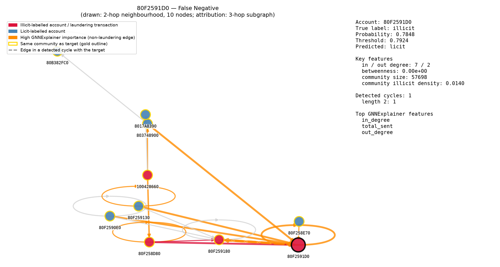
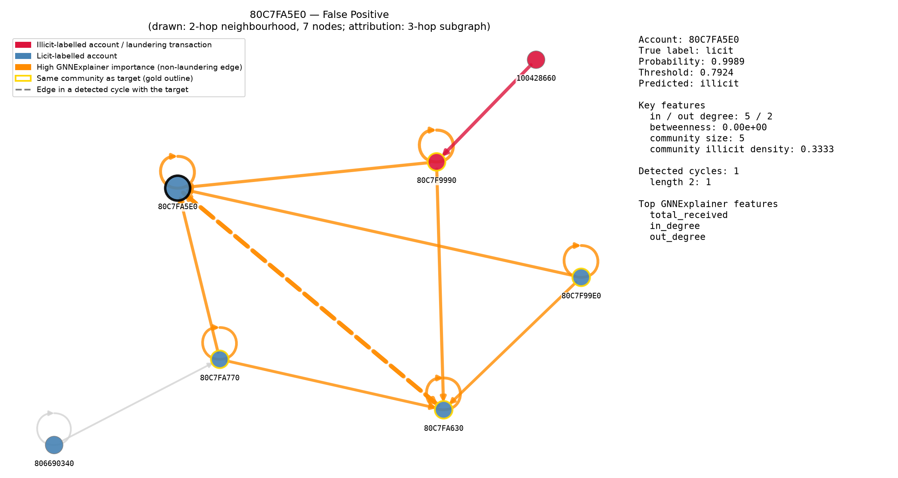

# Explainability Summary

Four accounts from the **test set only**, chosen by a fixed rule (select_samples): among test accounts in at least one detected cycle with 5-39 neighbours, the highest-probability true positive, the lowest-probability true positive, the highest-probability false negative, and the highest-probability false positive. See notebooks/explainability/.

## Methodology
- Ego-subgraph for visualization: 2-hop if that stays under 40 nodes, else 1-hop (built from the original MultiDiGraph, so real per-transaction `is_laundering` labels are available for edge coloring).
- Attribution: PyTorch Geometric's `GNNExplainer`, run on a 3-hop subgraph (matching the model's 3 SAGEConv layers) extracted via `k_hop_subgraph` — confirmed compatible with GraphSAGE with no NeighborLoader needed; tested first on one account (0.68s on a 2,381-node subgraph) before running on all four (largest: 2.82s on 14,916 nodes).
- Cycle membership: read from the shared exact cycle cache built by graph_analysis.py (all directed cycles of length 2-6).
- Community membership: read directly from account_features.csv (`community_id`).

## 80605A3E0 — True Positive Confident

- True label: ILLICIT, predicted probability: 0.9981 (threshold 0.7924)
- Sub-graph shown: 1-hop, 8 nodes
- Key features: in_degree=7, out_degree=3, betweenness=0.000001, community_illicit_density=0.0529, cycle_count=1
- Cycle membership: in 1 detected cycle(s), lengths [2]
- GNNExplainer top contributing features: in_degree (0.753), out_degree (0.712), in_out_amount_ratio (0.680), total_degree (0.661), community_size (0.624)
- GNNExplainer top contributing edges (neighbor influence): 805D4C850->80605A3E0 (0.715); 80605A3E0->80605A2A0 (0.711); 80605A070->80605A3E0 (0.676); 80605A110->80605A3E0 (0.670); 80605A840->80605A3E0 (0.653)

## 80FD04790 — True Positive Marginal

- True label: ILLICIT, predicted probability: 0.7925 (threshold 0.7924)
- Sub-graph shown: 2-hop, 19 nodes
- Key features: in_degree=8, out_degree=2, betweenness=0.000000, community_illicit_density=0.0117, cycle_count=1
- Cycle membership: in 1 detected cycle(s), lengths [2]
- GNNExplainer top contributing features: total_received (0.746), community_illicit_density (0.739), in_out_amount_ratio (0.734), out_degree (0.726), in_degree (0.713)
- GNNExplainer top contributing edges (neighbor influence): 80FD04790->80FD04330 (0.754); 80FD046A0->80FD04790 (0.707); 80FD042E0->80FD04790 (0.655); 80FD03D40->80FD04790 (0.650); 80FD03DE0->80FD04790 (0.595)

## 80F2591D0 — False Negative

- True label: ILLICIT, predicted probability: 0.7848 (threshold 0.7924)
- Sub-graph shown: 2-hop, 10 nodes
- Key features: in_degree=7, out_degree=2, betweenness=0.000000, community_illicit_density=0.0140, cycle_count=1
- Cycle membership: in 1 detected cycle(s), lengths [2]
- GNNExplainer top contributing features: in_degree (0.722), total_sent (0.690), out_degree (0.687), community_illicit_density (0.681), cycle_flag (0.678)
- GNNExplainer top contributing edges (neighbor influence): 80F2591D0->803748900 (0.767); 80F2591D0->80F259130 (0.741); 80F258D80->80F2591D0 (0.726); 80F2591D0->80F2590E0 (0.726); 80F2591D0->80F259180 (0.689)

## 80C7FA5E0 — False Positive

- True label: licit, predicted probability: 0.9989 (threshold 0.7924)
- Sub-graph shown: 2-hop, 7 nodes
- Key features: in_degree=5, out_degree=2, betweenness=0.000000, community_illicit_density=0.3333, cycle_count=1
- Cycle membership: in 1 detected cycle(s), lengths [2]
- GNNExplainer top contributing features: total_received (0.712), in_degree (0.699), out_degree (0.615), cycle_flag (0.610), total_sent (0.606)
- GNNExplainer top contributing edges (neighbor influence): 100428660->80C7F9990 (0.748); 80C7F9990->80C7FA5E0 (0.684); 80C7FA630->80C7F9990 (0.679); 80C7FA630->80C7FA5E0 (0.653); 80C7F99E0->80C7FA5E0 (0.651)

## Case-by-case narrative

**80605A3E0 (confident true positive):** true label illicit, probability 0.9981 vs threshold 0.7924 (+0.2057). It has 7 direct neighbour(s), 2 of them illicit-labelled; in/out degree 7/3; 1 detected cycle(s) (lengths [2]). GNNExplainer's top features: in_degree, out_degree, in_out_amount_ratio.

**80FD04790 (marginal true positive):** true label illicit, probability 0.7925 vs threshold 0.7924 (+0.0001). It has 7 direct neighbour(s), 1 of them illicit-labelled; in/out degree 8/2; 1 detected cycle(s) (lengths [2]). GNNExplainer's top features: total_received, community_illicit_density, in_out_amount_ratio. A borderline catch: small changes to the threshold would drop it.

**80F2591D0 (false negative):** true label illicit, probability 0.7848 vs threshold 0.7924 (-0.0076). It has 6 direct neighbour(s), 2 of them illicit-labelled; in/out degree 7/2; 1 detected cycle(s) (lengths [2]). GNNExplainer's top features: in_degree, total_sent, out_degree. A miss: the account is in a cycle but still scored below the threshold, so cycle membership alone does not guarantee a flag.

**80C7FA5E0 (false positive):** true label licit, probability 0.9989 vs threshold 0.7924 (+0.2065). It has 4 direct neighbour(s), 1 of them illicit-labelled; in/out degree 5/2; 1 detected cycle(s) (lengths [2]). GNNExplainer's top features: total_received, in_degree, out_degree. A false alarm: its local structure resembles illicit accounts, which is why scores should support, not replace, manual review.
