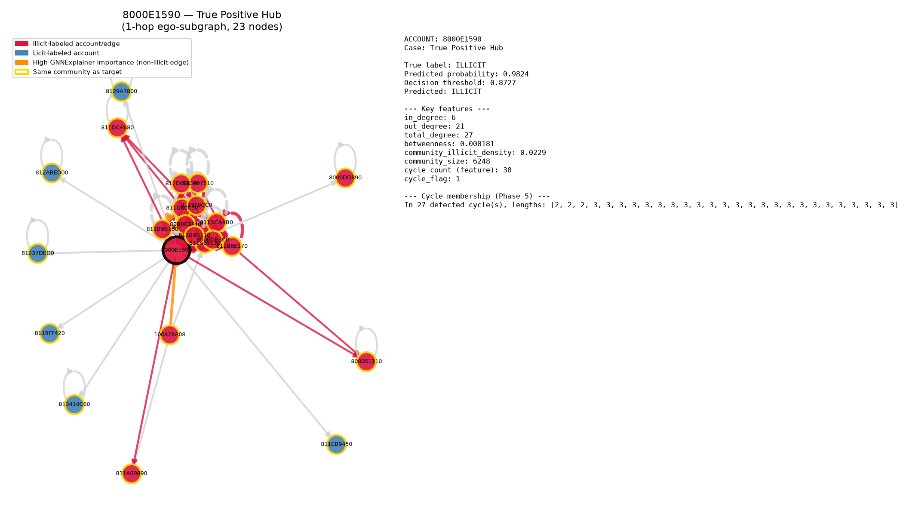
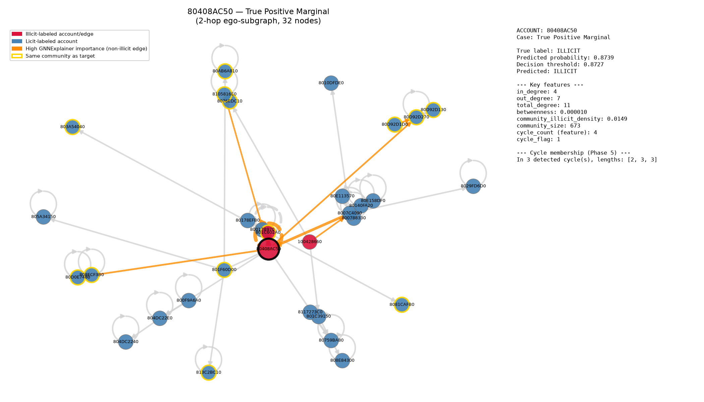
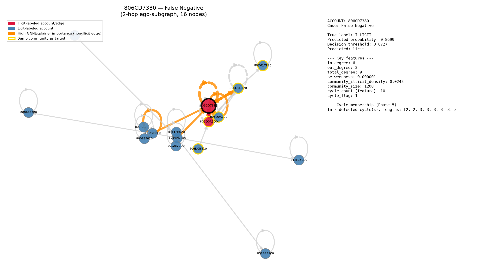

# Explainability Summary

Four accounts from the **test set only** (never seen in training), selected to cover true positive, false negative, and false positive cases — not cherry-picked as the single best-looking example, but chosen for having enough graph structure to make the explanation meaningful. See notebooks/explainability/ for the corresponding PNGs.

## Methodology
- Ego-subgraph for visualization: 2-hop if that stays under 40 nodes, else 1-hop (built from the original MultiDiGraph, so real per-transaction `is_laundering` labels are available for edge coloring).
- Attribution: PyTorch Geometric's `GNNExplainer`, run on a 3-hop subgraph (matching the model's 3 SAGEConv layers) extracted via `k_hop_subgraph` — confirmed compatible with GraphSAGE with no NeighborLoader needed; tested first on one account (0.68s on a 2,381-node subgraph) before running on all four (largest: 2.82s on 14,916 nodes).
- Cycle membership: cycle detection was recomputed once for this phase, reusing the exact functions and parameters from graph_analysis.py (same giant-SCC partial-sample caveat applies — see that module).
- Community membership: read directly from account_features.csv (`community_id`).

## 8000E1590 — True Positive Hub

- True label: ILLICIT, predicted probability: 0.9824 (threshold 0.8727)
- Sub-graph shown: 1-hop, 23 nodes
- Key features: in_degree=6, out_degree=21, betweenness=0.000181, community_illicit_density=0.0229, cycle_count=30
- Cycle membership: in 27 detected cycle(s), lengths [2, 2, 2, 3, 3, 3, 3, 3, 3, 3, 3, 3, 3, 3, 3, 3, 3, 3, 3, 3, 3, 3, 3, 3, 3, 3, 3]
- GNNExplainer top contributing features: betweenness (0.717), in_out_amount_ratio (0.711), in_degree (0.710), total_degree (0.709), cycle_flag (0.699)
- GNNExplainer top contributing edges (neighbor influence): 811A00890->8000E1590 (0.646); 8119F8CC0->8000E1590 (0.640); 800051110->8000E1590 (0.631); 812D06150->8000E1590 (0.629); 811DCA680->8000E1590 (0.618)

## 80408AC50 — True Positive Marginal

- True label: ILLICIT, predicted probability: 0.8739 (threshold 0.8727)
- Sub-graph shown: 2-hop, 32 nodes
- Key features: in_degree=4, out_degree=7, betweenness=0.000010, community_illicit_density=0.0149, cycle_count=4
- Cycle membership: in 3 detected cycle(s), lengths [2, 3, 3]
- GNNExplainer top contributing features: total_degree (0.765), in_degree (0.727), community_size (0.700), out_degree (0.698), cycle_flag (0.695)
- GNNExplainer top contributing edges (neighbor influence): 8007C4090->80408AC50 (0.685); 80759BA80->80408AC50 (0.684); 80D92D270->80408AC50 (0.679); 80408AC50->80408AC50 (0.673); 801C602A0->80408AC50 (0.671)

## 806CD7380 — False Negative

- True label: ILLICIT, predicted probability: 0.8699 (threshold 0.8727)
- Sub-graph shown: 2-hop, 16 nodes
- Key features: in_degree=6, out_degree=3, betweenness=0.000001, community_illicit_density=0.0248, cycle_count=10
- Cycle membership: in 8 detected cycle(s), lengths [2, 2, 3, 3, 3, 3, 3, 3]
- GNNExplainer top contributing features: total_degree (0.732), total_received (0.717), cycle_flag (0.715), in_degree (0.712), out_degree (0.698)
- GNNExplainer top contributing edges (neighbor influence): 805A7B0B0->805A7B0B0 (0.847); 806D0A220->806D0A220 (0.839); 806CD7380->806D0A1D0 (0.828); 806CD7380->806D0B320 (0.796); 806D0B320->806CD7380 (0.762)

## 80C7FA5E0 — False Positive

- True label: licit, predicted probability: 0.9961 (threshold 0.8727)
- Sub-graph shown: 2-hop, 7 nodes
- Key features: in_degree=5, out_degree=2, betweenness=0.000000, community_illicit_density=0.2000, cycle_count=4
- Cycle membership: in 3 detected cycle(s), lengths [2, 3, 3]
- GNNExplainer top contributing features: community_size (0.689), cycle_flag (0.672), total_degree (0.671), in_degree (0.670), out_degree (0.654)
- GNNExplainer top contributing edges (neighbor influence): 80C7FA5E0->80C7FA5E0 (0.685); 80C7F9990->80C7FA5E0 (0.683); 80C7FA630->80C7FA5E0 (0.677); 80C7FA770->80C7FA5E0 (0.670); 100428660->80C7F9990 (0.611)

## Case-by-case narrative

**8000E1590 (confident true positive):** this account also appeared in Phase 5's suspicious 6-cycle visualization — flagged as structurally notable before any label was used. The model agrees with high confidence (0.982), and GNNExplainer's top features/edges show why: high degree, heavy cycle participation, and neighbors that are themselves illicit or highly central. This is the model working as intended — structural signal and labels align.

**80408AC50 (marginal true positive):** correctly caught, but only just — probability 0.8739 is barely above the 0.8727 threshold. This is a realistic 'good but not overwhelming' catch, useful for calibrating how much confidence to place in borderline flags from this model.

**806CD7380 (false negative, honest miss):** true label is illicit, but the model scored it 0.8699 — just under the 0.8727 threshold. Notably, this account IS in 8 detected cycle(s) (lengths [2, 2, 3, 3, 3, 3, 3, 3]), which normally correlates with illicit activity — so cycle participation alone wasn't enough here. The likely explanation, per GNNExplainer's attribution, is that this account's immediate neighbors are predominantly licit-labeled, so message-passing diluted the cycle signal below the decision threshold. This illustrates a real limitation: an account embedded mostly among legitimate accounts, even if it participates in a suspicious cycle, can still slip under the threshold.

**80C7FA5E0 (false positive, honest false alarm):** true label is licit, but the model was highly confident it was illicit (0.9961). This account is itself in 3 detected cycle(s) (lengths [2, 3, 3]), which is very likely what misled the model — cycle participation is a strong learned signal, but not every account in a short transaction cycle is actually laundering money; some cyclic payment patterns (e.g. reciprocal business payments) are entirely legitimate. This is a good example of why the model's output should support, not replace, manual review — a high score here would trigger unnecessary investigation.
